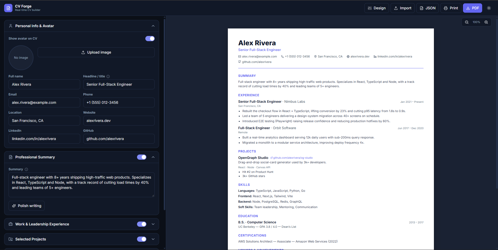

# CV Forge

A modern, fully client-side CV / résumé builder. Fill in your details on the left, watch a polished A4 document update live on the right, then export to **PDF**, print, or save your data as JSON — all in the browser, with **no account and no backend**.



> Your data never leaves your machine. Everything runs locally and auto-saves to your browser's `localStorage`.

---

## ✨ Features

- **Live split-screen editor** — form on the left, real-time A4 preview on the right.
- **4 templates** — Modern Minimalist, Tech Single Column, Creative Split, Classic (ATS-friendly).
- **Full customization** — accent color, font, and spacing density.
- **Rich sections** — personal info with avatar, professional summary (with one-click "polish"), work experience, projects, education, skills, and honors.
- **Section visibility toggles** — show/hide any section without deleting its content.
- **Export & import**
  - High-quality **PDF** export.
  - Native **Print** (vector-sharp, true A4).
  - **JSON** export/import so you can back up and reload your CV anytime.
- **Auto-save** — your work is persisted locally as you type.
- **Light & dark** workspace themes.
- **Zero dependencies at runtime beyond React** — no tracking, no sign-up, no server.

---

## 🚀 Run it locally

You need **[Node.js](https://nodejs.org/) 18 or newer** (includes `npm`). Check with `node -v`.

```bash
# 1. Clone the repository
git clone https://github.com/L3nvil/cv-forge.git
cd cv-forge

# 2. Install dependencies
npm install

# 3. Start the dev server
npm run dev
```

Then open the URL it prints (usually **http://localhost:5173**) in your browser.

That's it — the app runs entirely in your browser.

---

## 📦 Build for production

To create an optimized static build:

```bash
npm run build      # outputs to the ./dist folder
npm run preview    # serve the production build locally to test it
```

The contents of `dist/` are plain static files (HTML/CSS/JS) and can be hosted anywhere.

---

## 🛠️ Tech stack

| Area | Choice |
| --- | --- |
| Framework | [React 18](https://react.dev/) + [TypeScript](https://www.typescriptlang.org/) |
| Build tool | [Vite 5](https://vitejs.dev/) |
| Styling | [Tailwind CSS 3](https://tailwindcss.com/) |
| Icons | [Lucide React](https://lucide.dev/) |
| PDF export | [html2pdf.js](https://github.com/eKoopmans/html2pdf.js) |
| State / persistence | React hooks + `localStorage` |

---

## 📁 Project structure

```
src/
├── App.tsx                 # Dual-pane layout, toolbar, theme & zoom
├── main.tsx                # React entry point
├── index.css               # Tailwind layers, theme variables, print CSS
├── types/cv.ts             # CVData model, templates, fonts, accent presets
├── lib/
│   ├── defaults.ts         # Seed CV, density tokens
│   ├── export.ts           # PDF / JSON / print helpers
│   └── polish.ts           # Local summary-polish heuristic
├── hooks/
│   ├── useLocalStorage.ts  # Persisted state hook
│   └── useTheme.ts         # Light/dark theme hook
└── components/
    ├── FormBuilder.tsx     # Left panel — all form sections
    ├── CVPreview.tsx       # Right panel — A4 canvas + templates
    ├── Customizer.tsx      # Template / color / font / density controls
    ├── AvatarUploader.tsx  # Avatar upload with zoom/offset
    └── ui.tsx              # Shared primitives (Field, TagInput, Toggle, …)
```

---

## 🤝 Contributing

Issues and pull requests are welcome. For significant changes, please open an issue first to discuss what you'd like to change.

## 📄 License

Released under the [MIT License](LICENSE).
